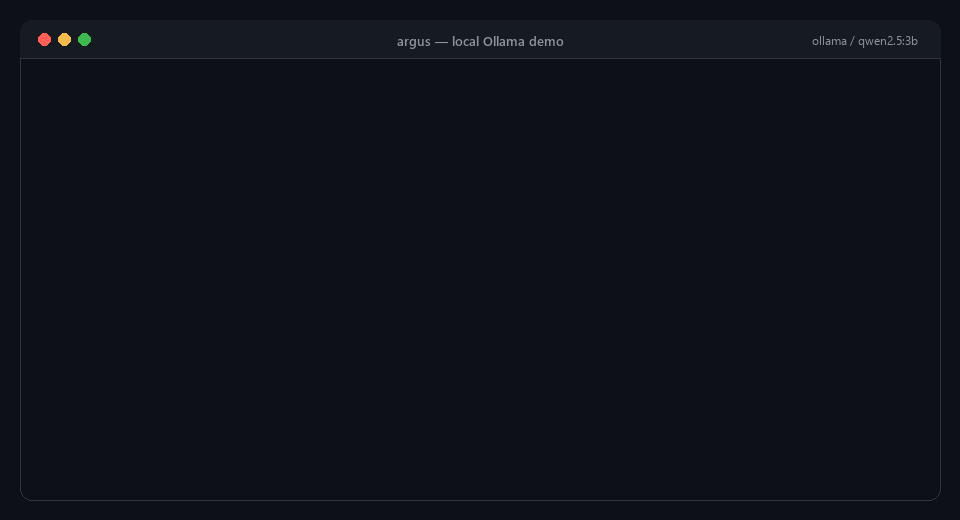
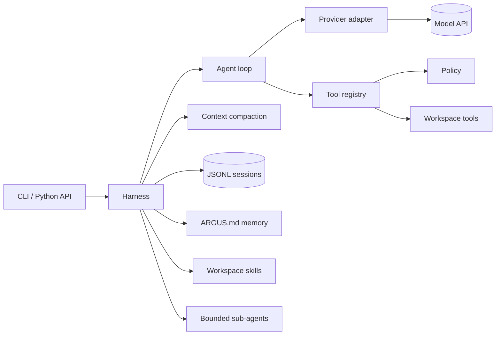

# Argus

**A small, inspectable Python agent harness for real work inside one directory.**

[](https://github.com/PRINCE2-AI/Argus/actions/workflows/ci.yml)
[](https://github.com/PRINCE2-AI/Argus/pkgs/container/argus)
[](https://www.python.org/downloads/)
[](LICENSE)
[](#design-principles)

**English** · [Español](docs/i18n/README.es.md) · [हिन्दी](docs/i18n/README.hi.md) · [Français](docs/i18n/README.fr.md)

Argus connects a language model to a focused set of workspace tools, keeps every
action inside a path jail, records durable sessions, and turns safety decisions
into readable code instead of hidden framework behavior. It supports six model
providers, four interface languages, and ships with no runtime dependencies.

It is built for people who want to understand, test, and extend their agent —
not inherit a black box.

[Live site](https://argus-harness-oa3gk1gz2f0.qoder.website) ·
[Docs](https://argus-harness-oa3gk1gz2f0.qoder.website/docs.html) ·
[Architecture](docs/ARCHITECTURE.md) ·
[Portfolio notes](docs/PORTFOLIO.md) ·
[Newsletter](https://thereliableagent.substack.com)



---

## Why Argus?

Most agent frameworks are large, opaque, and hard to audit. Argus takes the
opposite approach:

- **Small surface area.** Every boundary — provider, loop, tools, policy,
  sessions, compaction — is a module you can read in one sitting.
- **Safety is explicit.** A deterministic deny list, path jail, approval flow,
  secret redaction, and optional semantic review layer. No silent auto-approval
  in headless runs.
- **Sessions survive reality.** Torn JSONL tails, interrupted tool calls, and
  process restarts are repaired instead of losing work.
- **Provider-neutral.** Gemini, Anthropic, OpenAI, OpenRouter, Groq, and local
  Ollama share one neutral message format.
- **International from day one.** English, Spanish, Hindi, and French CLI
  strings plus translated READMEs.
- **Zero runtime dependencies.** Python 3.10+ standard library only.

---

## Quick start

### Requirements

- Python 3.10 or newer
- An API key for a cloud provider, or a local [Ollama](https://ollama.com) model

### 1. Install

Argus is not on PyPI yet. Install from source:

```bash
git clone https://github.com/PRINCE2-AI/Argus.git
cd Argus
python -m venv .venv
source .venv/bin/activate        # Windows: .venv\Scripts\activate
pip install .
```

The distribution name is `argus-harness`; the command is `argus`. For
development, use `pip install -e ".[dev]"` instead.

Or pull the container image:

```bash
docker pull ghcr.io/prince2-ai/argus:latest
```

Each GitHub release builds and verifies the wheel and sdist, publishes the GHCR
image, and attaches the distributions to the release.

### 2. Configure a provider

```bash
cp .env.example .env             # Windows: copy .env.example .env
```

Add one key to `.env`:

```dotenv
GEMINI_API_KEY=your-key-here
```

`.env` is ignored by Git. Argus loads it from the current directory first, then
from the repository root, without overwriting variables already present in your
environment.

### 3. Run a task

```bash
# Interactive
argus

# Headless, auto-approving tool calls in safe mode
argus --prompt "Create hello.py, run it, and report the output" --yes

# Review-only exploration (no writes, no shell commands)
argus --prompt "Summarize this repository" --mode read-only

# Resume the newest session
argus --resume

# List saved sessions
argus --list-sessions
```

Use `python -m argus` anywhere in place of `argus`.

---

## Provider support

Argus infers a provider from the model name or `ARGUS_PROVIDER`, and every
provider can be selected explicitly with `--provider`.

| Provider | `--provider` | Default model | API key environment |
| --- | --- | --- | --- |
| Google Gemini | `gemini` | `gemini-3.1-pro-preview` | `GEMINI_API_KEY` or `ARGUS_API_KEY` |
| Anthropic | `anthropic` | `claude-sonnet-4-5` | `ANTHROPIC_API_KEY` or `ARGUS_API_KEY` |
| OpenAI | `openai` | `gpt-4o-mini` | `OPENAI_API_KEY` or `ARGUS_API_KEY` |
| OpenRouter | `openrouter` | `openai/gpt-4o-mini` | `OPENROUTER_API_KEY` or `ARGUS_API_KEY` |
| Groq | `groq` | `llama-3.3-70b-versatile` | `GROQ_API_KEY` or `ARGUS_API_KEY` |
| Ollama (local) | `ollama` | `llama3.2` | none |

Override the model with `--model`, `<PROVIDER>_MODEL`, or `ARGUS_MODEL`.
Override the endpoint with `--base-url`, `<PROVIDER>_BASE_URL`, or
`ARGUS_BASE_URL`. Ollama deliberately ignores `ARGUS_API_KEY` so a cloud key is
never sent to localhost.

```bash
argus --provider anthropic --model claude-sonnet-4-5 --prompt "Review tools.py"
argus --provider openai --model gpt-4o-mini --prompt "Explain the session repair"
argus --provider ollama --model llama3.2 --prompt "Summarize this repository"
```

---

## Python API

```python
from argus import Harness, Policy

harness = Harness(
    workdir=".",
    provider="gemini",
    model="gemini-3.1-flash-lite",
    policy=Policy("safe"),
)

print(harness.run("Create a short project status file and verify it."))
```

Resume durable work after a restart:

```python
harness = Harness(workdir=".")
if harness.resume():
    print(harness.run("Continue the interrupted task."))
```

Inject a provider in tests or custom applications:

```python
from argus import Harness
from argus.providers import get_provider

provider = get_provider("openai", model="gpt-4o-mini", api_key="test-key")
harness = Harness(workdir=".", provider=provider)
```

### Add a tool without touching the harness

```python
from argus import Harness, tool

@tool("Look up a customer by email", email="Customer email address")
def find_customer(email):
    return {"email": email, "plan": "pro"}

harness = Harness(workdir=".", extra_tools=[find_customer])
print(harness.run("Find ada@example.com and report her plan."))
```

### Add a provider

Subclass `Provider`, implement `complete(system, messages, tools)` and return
normalized text, tool calls, usage, and a finish reason. Register it in
`argus/providers/__init__.py`. See [docs/ARCHITECTURE.md](docs/ARCHITECTURE.md).

---

## Safety model

Every tool call passes through a `Policy` before it runs.

| Mode | Behavior |
| --- | --- |
| `read-only` | Only read-oriented tools: `read_file`, `list_files`, `grep`, `use_skill`. |
| `safe` (default) | Mutating tools require an interactive approval. |
| `yolo` | Tools run automatically, but deterministic deny patterns still apply. |

The hard boundary is independent of the mode:

- Filesystem tools resolve paths inside the workspace; `..` escapes, symlink
  escapes, and protected paths (`.env`, `.env.*`, `.git`, `.argus`) are rejected.
- Shell commands matching destructive patterns are denied: root/home removal,
  parent-directory traversal, `.git/.argus` deletion, privilege escalation,
  disk formatting, reverse shells, cloud metadata access, pipe-to-shell
  downloads, forced Git pushes, hard resets, and fork bombs.
- Headless runs have no approver. In `safe` mode, mutating tools are denied
  unless you pass `--yes`; use `--mode yolo` only in a trusted workspace.
- Tool output is redacted for common key formats and environment-secret values.
  Subprocesses receive a sanitized environment with secret-named variables
  removed.
- Optional Jev semantic review fails closed: low-confidence, malformed,
  unavailable, or dangerous decisions never silently authorize a command.

> **Argus is not an OS sandbox.** The policy reduces accidental damage; it does
> not isolate hostile code. Run untrusted tasks in a container or VM.

---

## Architecture



The harness composes the system prompt, tools, policy, memory, skills, and
session. The loop asks the provider for the next step, runs tool calls, records
results, and repeats until the model stops or the turn limit is reached. If the
turn limit is hit, Argus asks the model for one final tool-free wrap-up.

Key design points:

- **Neutral messages.** Providers convert to and from one internal format;
  Gemini thought signatures and Anthropic content blocks round-trip correctly.
- **Durable sessions.** JSONL files are appended as work happens. Loading
  tolerates a torn final line, removes pre-0.2 duplicate tool rows, restores the
  latest compaction, and inserts explicit error results for tool calls that were
  interrupted by a crash.
- **Factual compaction.** Older turns are summarized with a dedicated prompt;
  recent turns stay verbatim. The summary is marked in the session so a restart
  reloads only the compacted history.
- **Atomic writes.** `write_file` and `edit_file` write to a temporary file and
  atomically replace the target, so a failure cannot leave a half-written file.

See [docs/ARCHITECTURE.md](docs/ARCHITECTURE.md) for the full design.

---

## CLI reference

```text
argus [--prompt TEXT] [--workdir DIR] [--model NAME] [--provider NAME]
      [--base-url URL] [--mode safe|yolo|read-only] [--yes]
      [--max-turns N] [--budget-tokens N] [--lang en|es|hi|fr]
      [--resume | --session PATH] [--list-sessions]
      [--fleet FILE] [--workers N] [--version]
```

Interactive commands:

| Command | Purpose |
| --- | --- |
| `/help` | Show available commands. |
| `/mode safe\|yolo\|read-only` | Change the safety mode at runtime. |
| `/session` | Print the active session file. |
| `/tokens` | Show accumulated input/output tokens. |
| `/lang en\|es\|hi\|fr` | Switch the interface language. |
| `/exit` | Leave the session. |

### Fleet jobs

Run independent tasks in parallel while preserving input order in the report:

```json
{
  "jobs": [
    {"name": "api", "workdir": "./work/api", "task": "Add request validation and tests"},
    {"name": "docs", "workdir": "./work/docs", "task": "Rewrite the onboarding guide"}
  ]
}
```

```bash
argus --fleet fleet.json --workers 2 --mode yolo
```

---

## Internationalization

The CLI is available in English, Spanish, Hindi, and French:

```bash
argus --lang es
```

Set `ARGUS_LANG` for a persistent default. Argus also respects `LC_ALL`,
`LC_MESSAGES`, and `LANG` when they name a supported language. READMEs are
translated in [docs/i18n](docs/i18n).

---

## Project memory and skills

Durable project facts live in `ARGUS.md`; the model can add them with the
`remember` tool. Workspace skills live in `skills/<name>/SKILL.md` and are
listed in the system prompt; the model loads one on demand with `use_skill`.

```markdown
---
description: Write concise, friendly product copy
---

Use short sentences and a warm, practical tone.
```

Memory and skills are treated as reference data, not higher-priority
instructions, and the system prompt tells the model to ignore conflicting
directions inside them.

---

## Development

```bash
python -m unittest discover -s tests -v   # offline, deterministic
ruff check argus tests
python -m build
python -m twine check dist/*
```

The test suite uses a scripted provider, so it never calls a real model or
requires credentials. CI runs the suite on Python 3.10–3.13, lints the code, and
builds and installs the wheel outside the source tree.

Contributions are welcome. Read [CONTRIBUTING.md](CONTRIBUTING.md) before
opening a pull request. Please report vulnerabilities privately as described in
[SECURITY.md](SECURITY.md).

If Argus is useful to you, starring the repository helps other developers find
it.

---

## Docker

```bash
docker run --rm -it \
  --user "$(id -u):$(id -g)" \
  -v "$PWD:/workspace" \
  -e GEMINI_API_KEY \
  ghcr.io/prince2-ai/argus:latest \
  --prompt "Summarize this repository" --mode read-only
```

Build locally with `docker build -t argus .`. Tagged images are published to
GHCR on every GitHub Release (`ghcr.io/prince2-ai/argus`).

---

## Repository layout

```text
argus/
  __init__.py       Public API and version
  __main__.py       python -m argus entry point
  cli.py            Interactive, headless, session, and fleet modes
  config.py         .env loading and environment lookup
  context.py        Token budgeting and factual compaction
  fleet.py          Ordered parallel job execution
  harness.py        Composition layer
  i18n.py           CLI translations and locale resolution
  jev.py            Optional structured decision layer
  loop.py           Model/tool turn loop
  memory.py         ARGUS.md project memory and system prompt
  security.py       Policy, approvals, and deny patterns
  session.py        JSONL sessions, compaction restore, crash repair
  skills.py         Skill discovery and confined loading
  subagent.py       Bounded child-agent delegation
  tools.py          Workspace tools, path jail, redaction
  providers/
    base.py         Provider contract, HTTP transport, message helpers
    gemini.py       Gemini adapter
    openai.py       OpenAI-compatible, OpenRouter, Groq, Ollama
    anthropic.py    Anthropic Messages adapter
tests/              Offline unittest suite with a scripted provider
demos/              Small runnable examples
docs/               Architecture, portfolio notes, translations
.github/workflows/  CI and release automation
```

---

## Roadmap

- Streaming provider responses with cancellation.
- MCP client support behind the same policy boundary.
- Token-accurate budgeting per provider.
- Pluggable sandbox backends for untrusted execution.
- More interface languages.

---

## Following the work

Argus is built in public, and the harder lessons end up in **The Reliable Agent**
— a newsletter about production systems engineering for AI agents: evals,
MCP security, durable execution, and the failure modes that only appear once a
demo meets real work.

- [What 102 tests taught me about agent reliability](https://thereliableagent.substack.com/p/what-102-tests-taught-me-about-agent) — the test suite in this repository, and the four bugs it was written to catch.
- [Subscribe](https://thereliableagent.substack.com) — free posts on agent reliability; the paid tier adds runnable failure cases, eval harnesses, and teardowns.

No hot takes, no framework-of-the-week. If a claim is made, the code behind it is
in the post.

---

## License

MIT. See [LICENSE](LICENSE).
