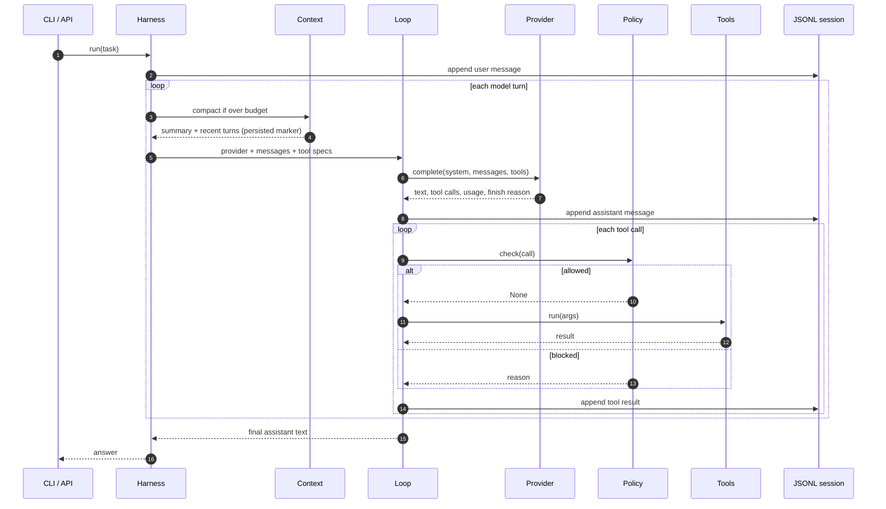

# Argus Architecture

This document explains how Argus is put together, why the boundaries sit where
they do, and what guarantees each layer provides.

## Design goals

1. **Inspectable over clever.** A developer should be able to read the full
   request path — CLI to provider to tool and back — without chasing framework
   internals.
2. **Explicit safety.** Every mutation passes through one policy object. The
   deny list is deterministic and testable. Optional semantic review fails
   closed.
3. **Durable work.** A crash should not silently lose a session or leave the
   next request with malformed tool history.
4. **Provider-neutral core.** The loop, tools, sessions, and policy know nothing
   about any vendor's wire format.
5. **No hidden dependencies.** Runtime code uses the Python standard library
   only. Tests use a scripted provider.

Non-goals: being an OS sandbox, a multi-tenant service, or a full agent
framework with plugins, vector stores, and a web UI.

## Request flow



`Harness.run` owns persistence and usage accounting. `loop.run` owns the turn
mechanics and is usable on its own (the demos do this).

## Module map

| Module | Responsibility | Depends on |
| --- | --- | --- |
| `cli.py` | Argument parsing, approval UI, interactive commands, fleet mode | Harness, i18n, session |
| `harness.py` | Composition, persistence, compaction hook, usage, sub-agents | loop, tools, policy, memory, skills |
| `loop.py` | Turn loop, tool execution, error containment, turn-limit wrap-up | providers |
| `providers/base.py` | Provider contract, HTTP retries, call-ID pairing, usage shape | config |
| `providers/gemini.py` | Gemini `generateContent` translation and parsing | base |
| `providers/openai.py` | OpenAI-compatible, OpenRouter, Groq, Ollama | base |
| `providers/anthropic.py` | Anthropic Messages translation and parsing | base |
| `tools.py` | File, shell, grep, list tools; path jail; redaction | config |
| `security.py` | Modes, deny patterns, approvals, Jev integration | jev |
| `context.py` | Token estimate and factual compaction | providers |
| `session.py` | JSONL append/load, torn-tail tolerance, repair, listing | none |
| `memory.py` | `ARGUS.md`, system prompt construction | none |
| `skills.py` | `skills/*/SKILL.md` discovery and confined reads | none |
| `subagent.py` | Bounded child harness tool | tools |
| `fleet.py` | Ordered parallel job execution | none |
| `i18n.py` | CLI translations and locale resolution | none |
| `config.py` | `.env` loading without overwriting the environment | none |

## Neutral message format

Argus stores and passes messages as plain dictionaries:

```python
{"role": "user", "text": "Create hello.py"}

{
    "role": "assistant",
    "text": "",
    "tool_calls": [
        {"id": "call_ab12", "name": "write_file",
         "args": {"path": "hello.py", "content": "print('hi')\n"}}
    ],
    "finish_reason": "tool_calls",
}

{"role": "tool", "name": "write_file", "call_id": "call_ab12",
 "text": "Wrote 12 chars to hello.py"}
```

Compaction summaries are user messages with
`meta = {"compaction": True, "replaced": N}`. Gemini thought signatures are
attached to individual tool calls as `signature` so Gemini 3 can round-trip
them.

`ensure_call_ids` fills missing call IDs and pairs tool results with pending
calls before a provider request. This keeps older or hand-built histories valid.

## Provider adapters

All adapters implement:

```python
complete(system: str, messages: list[dict], tools: list[dict]) -> dict
```

and return:

```python
{
    "text": str,
    "tool_calls": [{"id": str, "name": str, "args": dict}],
    "usage": {"input": int, "output": int, "total": int, ...},
    "finish_reason": str,
}
```

| Adapter | Request shape | Tool format | Notable handling |
| --- | --- | --- | --- |
| Gemini | `contents` + `systemInstruction` | `functionDeclarations` | Safety blocks, prompt blocks, thought parts, signatures |
| OpenAI-compatible | `messages` | `tools[].function` | Reasoning models use `max_completion_tokens` and omit temperature |
| OpenRouter | OpenAI shape | OpenAI shape | Adds attribution headers |
| Groq | OpenAI shape | OpenAI shape | Same adapter, different base URL |
| Ollama | OpenAI shape | OpenAI shape | No key required; ignores `ARGUS_API_KEY` |
| Anthropic | Content blocks | `tools[].input_schema` | Merges consecutive tool results into one user turn |

HTTP requests use `urllib.request` with five attempts for retryable statuses
(408, 409, 429, 500, 502, 503, 504) and network errors, honoring `Retry-After`
up to 60 seconds. Non-retryable errors raise `ProviderError` with the status.

Configuration precedence for every provider is: explicit constructor argument →
provider-specific environment variable → `ARGUS_*` fallback → built-in default.
Ollama is the deliberate exception for API keys.

## Safety boundary

Safety is layered; each layer is independently testable.

1. **Mode policy** (`Policy.mode`): `read-only` allows only read tools,
   `safe` asks for interactive approval before mutations, `yolo` allows tools
   automatically. The default is `safe` everywhere.
2. **Deterministic deny list** (`DENY_PATTERNS`): applies even in `yolo`.
   It covers root/home/parent removal, `.git`/`.argus` deletion, `cd ..`,
   reads or copies of `.env`, `find -delete`, `sudo`, disk formatting, writes
   to system paths, pipe-to-shell downloads, reverse shells, cloud metadata,
   forced Git operations, and fork bombs.
3. **Path jail** (`resolve` in `tools.py`): realpath + commonpath confinement.
   Protected path components (`.env`, `.env.*`, `.git`, `.argus`) are rejected
   for reads, writes, listing, and grep.
4. **Approval flow**: the CLI only builds an interactive approver when stdin is
   a TTY. Headless safe mode has no approver, so mutations are denied. `--yes`
   installs a fixed approver for automation; `yolo` is a separate explicit
   choice.
5. **Optional Jev review**: when configured, a command classified as
   `dangerous` or `review` (outside `yolo`) is blocked. Unknown labels,
   confidence below 0.6, and exceptions are treated as unsafe.
6. **Secret containment**: tool output is redacted against key formats and
   secret environment values; bash subprocesses receive an environment with
   secret-named variables removed; `.env` and `.argus` are excluded from
   listings and grep.
7. **Residual risk**: shell commands are still shell commands. The policy is
   pattern-based defense in depth, not a container boundary. Use a container or
   VM for untrusted tasks.

## Durable sessions

Sessions are JSONL files under `<workspace>/.argus/sessions/`. Each message is
written as one JSON object per line, in order, as the run progresses.

On load:

1. Parse lines until the first JSON error. A torn final line is ignored.
2. Remove adjacent duplicate tool rows created by older Argus versions.
3. Slice at the last compaction marker, if any.
4. Drop leading tool rows that have no preceding assistant call in the slice.
5. Find the last assistant message and compare its tool calls with the tool
   results that follow. Missing calls get an explicit
   `"Interrupted before this ran (process restarted)."` tool result, paired by
   call ID when available or by position otherwise.

This makes a resumed conversation valid for strict providers such as Anthropic
and Gemini, which reject orphaned tool results or unanswered tool calls.

`Harness.run` records messages through a `recorded_index` cursor. The assistant
message is appended to the in-memory list before the `assistant` event, and the
tool message before the `tool_end` event, so exactly one copy of each is
persisted — the bug that produced duplicates in 0.1.0.

`write_file` and `edit_file` use `mkstemp` + `os.replace` in the target
directory, so a failure leaves the original file untouched.

## Context compaction

`context.estimate_tokens` approximates one token per four characters of the
string representation of all messages. Before each model turn, `Harness` calls
`compact` with the configured budget (600,000 by default).

Compaction triggers only when the estimate exceeds the budget and there are
more than `KEEP_RECENT + 1` messages. It summarizes everything except the last
six messages using the provider itself with a factual summary prompt, drops
leading tool rows from the recent window, and prepends a marked summary.
Summaries are persisted immediately so a crash after compaction does not
replay the pre-summary turn.

Tradeoff: character-based budgeting is provider-agnostic and cheap, but less
accurate than tokenizer-specific counting. This is an explicit roadmap item.

## Memory and skills

`ARGUS.md` is injected into the system prompt inside `<project_memory>`
delimiters, truncated at 20,000 characters. Skills are discovered at
`skills/<name>/SKILL.md`, described in a compact catalog, and loaded through the
`use_skill` tool with a 64,000-character cap. Names are validated and resolved
inside the skills root.

Both are explicitly labeled as reference data, and the system prompt instructs
the model not to follow conflicting instructions found inside them. This does
not make prompt injection impossible; it makes the trust boundary explicit.

## Delegation and fleets

Sub-agents are fresh `Harness` instances with the same provider and policy,
their own clean message history, persistence disabled, and a maximum depth of
two. They return only their final report to the parent.

`run_fleet` runs independent jobs in a `ThreadPoolExecutor`, returns results in
input order regardless of completion order, captures per-job exceptions as
failures, and reports elapsed seconds. Shared provider and policy objects are
safe for these read-through uses; each job has its own workspace and harness.

## Internationalization

`i18n.py` holds complete translation dictionaries for English, Spanish, Hindi,
and French. `resolve_lang` prefers an explicit flag, then `ARGUS_LANG`, then
locale variables. Unknown languages and keys fall back to English safely.
`Ui` emits localized events and approval prompts; all dictionaries are checked
for key parity in the test suite.

## Testing strategy

The suite is deterministic and offline:

- `ScriptedProvider` returns pre-built normalized replies and records requests.
- Fake transports verify provider wire formats and HTTP retry behavior.
- Temporary directories exercise the real filesystem tools and sessions.
- Tests avoid reading `.env` values into assertions; secrets never appear in
  fixtures.
- The suite covers policy allows/denies, path escapes, session repair and
  compaction, loop containment, harness persistence, i18n parity, memory/skill
  confinement, and fleet ordering.

Run it with:

```bash
python -m unittest discover -s tests -v
```

## Extension points

- **Provider:** subclass `Provider`, implement `complete`, register it.
- **Tool:** decorate a function with `@tool`; pass it via `extra_tools`.
- **Policy:** supply a custom `Policy` approver or a decision model.
- **Front end:** call `Harness` directly from a service, bot, or scheduler.
- **Context strategy:** replace `before_turn` in a direct `loop.run` call, or
  adjust `budget_tokens`.

## Known tradeoffs

- Character-based token estimates can under- or over-compact for some models.
- Tool execution is sequential within a turn; parallel tool calls are a future
  improvement.
- JSONL sessions are append-only and compacted at load; no index or query layer.
- The deny list is pattern-based and cannot fully model shell semantics.
- Responses are non-streaming.
